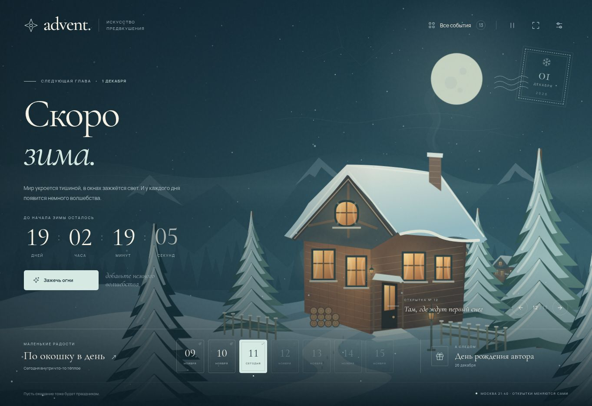

# Advent · Время предвкушать

Полноэкранный адвент-календарь из живых открыток. Он выбирает ближайший особенный день, показывает оставшееся время и каждый день предлагает открыть маленький сюрприз. У каждого события — собственная иллюстрация, настроение, атмосферные частицы и действие.

В 00:00 выбранного дня отсчёт сменяется праздничным режимом. Открытка празднует **весь календарный день**, а в следующую полночь автоматически начинается ожидание следующего события. Обновлять страницу для смены открытки не нужно.

Это обычный статический сайт: **HTML, CSS и нативные JavaScript-модули**, без сборщика, npm-зависимостей и серверной части. Иллюстрации и анимация создаются локальным кодом; шрифты входят в репозиторий. Внешние API, аналитика и телеметрия не используются.




## События

| Дата | Событие |
| --- | --- |
| 1 января | Новый год |
| 23 февраля | День защитника Отечества |
| 1 марта | Начало весны |
| 8 марта | Международный женский день |
| 1 мая | Праздник Весны и Труда |
| 9 мая | День Победы |
| 1 июня | Начало лета |
| 12 июня | День России |
| 1 сентября | День знаний |
| 1 сентября | Начало осени |
| 4 ноября | День народного единства |
| 1 декабря | Начало зимы |
| 26 декабря | День рождения автора календаря |

Всего **13 событий и 12 разных дат** в году. 1 сентября оба события сохраняются в календаре; основная открытка посвящена Дню знаний, а начало осени отмечается рядом. В галерее можно отдельно посмотреть каждую из двух открыток. Сезоны начинаются по календарным датам, без расчёта астрономических равноденствий.

## Как пользоваться

- **Главная открытка** сама следует за календарём. Таймер показывает дни, часы, минуты и секунды до начала события.
- **Ежедневные окошки** открывают небольшое пожелание или идею для дня. Прошедшие окошки можно открыть снова; будущие остаются закрыты до своей даты. Полоса дней не выходит за границы текущего периода ожидания.
- **Галерея открыток** позволяет заранее увидеть каждое оформление и его праздничное состояние. Это отдельные демонстрационные часы: просмотр будущей открытки не меняет системное время и реальный порядок событий. Чтобы продолжить обычный отсчёт, вернитесь к текущему событию.
- **Настройки** переключают часовой пояс между Москвой и часовым поясом устройства. По умолчанию используется `Europe/Moscow`, поэтому праздник начинается одновременно для всех, кто оставил эту настройку.
- **Движение** можно приостановить. Учитывается системная настройка уменьшения анимации; скрытая вкладка не должна расходовать ресурсы на постоянную отрисовку.

Настройки и открытые окошки сохраняются в `localStorage` **этого браузера**. Они не отправляются на сервер и не синхронизируются между устройствами. Если браузер запрещает локальное хранилище, календарь продолжает работать, но состояние может не сохраниться после закрытия страницы. Демо-окошки отделены от настоящего ожидания.

Часы сайта опираются на время устройства. При неверно установленной системной дате отсчёт тоже будет неверным; отдельного обращения к серверу времени нет.

Коллекция сюрпризов содержит 36 общих маленьких историй и по 3 тематические на событие. Они чередуются предсказуемо по дате; в любом окне из 24 дней один и тот же текст не повторяется.

Прямой предпросмотр: `?preview=birthday&mode=celebration` или `?preview=summer&mode=countdown`. Эти параметры не меняют настоящий календарь. Кнопка **К сегодняшнему дню** возвращает автоматический выбор.

## Локальный запуск

Нужен Node.js 20 или новее. Устанавливать npm-пакеты не требуется.

```bash
git clone https://github.com/i12309/Advent.git
cd Advent
npm run dev
```

Откройте [http://127.0.0.1:5173](http://127.0.0.1:5173). Сервер раздаёт файлы напрямую, поэтому после изменения исходников достаточно обновить страницу.

Другой адрес или порт:

```bash
npm run dev -- --host 0.0.0.0 --port 8080
```

Также поддерживаются переменные окружения `HOST` и `PORT`. Для работы нативных модулей нужен HTTP-сервер: открытие `index.html` через `file://` не поддерживается. Вместо встроенного сервера можно использовать любой другой статический HTTP-сервер.

## Проверки

```bash
npm run check
npm test
```

Проверка синтаксиса охватывает файлы `js/*.js` и `scripts/*.mjs`. Тесты календаря проверяют весь праздничный день, точную границу полуночи, переход года, день рождения, совпадение событий 1 сентября, високосный год, разные часовые пояса и дни смены летнего времени, изоляцию предпросмотра и блокировку будущих окошек.

Тесты сюрпризов проверяют воспроизводимость, корректность дат и отсутствие повторений в 24-дневном окне. Всего 22 автоматических проверки. Для ручной проверки компоновки после локального запуска откройте `/tests/viewports.html`: внутри находятся настоящие iframe размером 390×844, 360×640 и 768×1024 с выбором события и режима.

## Устройство проекта

| Файл / каталог | Назначение |
| --- | --- |
| `index.html` | Семантическая разметка открытки, управления и диалогов |
| `css/style.css` | Адаптивная композиция, типографика, темы и CSS-анимации |
| `js/events.js` | Единственный реестр ежегодных дат и подписей |
| `js/calendar.js` | Чистая логика времени, праздников, предпросмотра и адвент-дней |
| `js/artwork.js` | Иллюстрации открыток и их цветовые палитры |
| `js/atmosphere.js` | Canvas-частицы, праздничные эффекты и реакция на действие |
| `js/stories.js` | Истории открыток и ежедневные сюрпризы |
| `js/daily-moments.js` | Общая коллекция сюрпризов и выбор без повторов в 24 днях |
| `js/app.js` | Связь интерфейса, часов, настроек и состояния браузера |
| `js/icons.js` | Локальные векторные иконки |
| `assets/` | Фавикон, локальные шрифты и их лицензии |
| `tests/` | Автоматические проверки |
| `scripts/` | Локальный HTTP-сервер и проверка синтаксиса |
| `.github/workflows/pages.yml` | Проверки и публикация статических файлов в GitHub Pages |

Основная сцена построена отдельными слоями: иллюстрация задаёт композицию, CSS оживляет её детали, Canvas добавляет атмосферу. Текст и элементы управления остаются обычным HTML. Календарная логика не зависит от графики и тестируется без браузера.

## Добавить событие

Добавьте объект в массив `EVENTS` в `js/events.js`:

```js
{
  id: 'special-day',        // Уникальный постоянный идентификатор.
  month: 7,                // Месяц от 1 до 12.
  day: 15,                 // День месяца.
  title: 'Особенный день',
  until: 'особенного дня',  // Фраза после «до».
  greeting: 'С особенным днём!',
  eyebrow: 'Повод улыбнуться',
  description: 'Одна короткая фраза о настроении этой открытки.',
  category: 'personal',    // holiday, season или personal.
  priority: 50,            // Больший приоритет выбирает главную открытку при совпадении дат.
  theme: 'winter',         // Для первого шага можно использовать существующую тему.
  accent: '#c8d8e1',
  icon: 'gift',            // Имя одной из локальных иконок.
}
```

Даты повторяются ежегодно, следующий год рассчитывается автоматически. При совпадении дат сохраняются все события, а `priority` определяет основное. Отдельный год рождения для авторского дня рождения не нужен: возраст не рассчитывается и не показывается.

Для полностью самостоятельной открытки добавьте свою палитру и иллюстрацию в `artwork.js`, атмосферу в `atmosphere.js` и историю с действием и подарками в `stories.js`, затем укажите её идентификатор в `theme`. Для неизвестной истории предусмотрен зимний запасной вариант; для новой даты можно начать с уже существующего оформления и затем нарисовать своё.

После изменения реестра обновите ожидаемый список в тесте событий и выполните `npm run check` и `npm test`.

## GitHub Pages

Репозиторий подготовлен для публикации по адресу [https://i12309.github.io/Advent/](https://i12309.github.io/Advent/). Адрес станет доступен после включения Pages и успешного выполнения workflow; наличие кода в репозитории само по себе не подтверждает публикацию.

Первичная настройка в GitHub:

1. Откройте **Settings → Pages**.
2. В разделе **Build and deployment → Source** выберите **GitHub Actions**.
3. Откройте вкладку **Actions**, выберите **Verify and deploy Advent** и запустите **Run workflow** для ветки `main`, если публикация ещё не запущена новым коммитом.
4. Дождитесь успешного завершения задания `deploy`.

При следующих обновлениях `main` workflow сначала выполняет проверки, затем публикует сайт. В артефакт попадают только `index.html`, `.nojekyll`, `assets/`, `css/` и `js/`; тесты, инструменты разработки и локальная конфигурация предпросмотра не публикуются. Workflow не включает Pages автоматически и не публикует другие ветки.

Пока Pages не включён, workflow выполняет проверки и оставляет инструкцию в своём отчёте, а этап публикации пропускает. Это успешная проверка исходников, **не подтверждение доступности сайта**.

## Шрифты

Используются локальные **Cormorant Garamond** и **Manrope**, распространяемые по **SIL Open Font License 1.1**. Файлы лицензий находятся рядом со шрифтами в `assets/`. Страница не загружает Google Fonts или другие внешние ресурсы во время работы.
